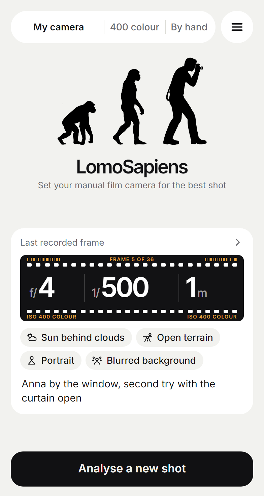
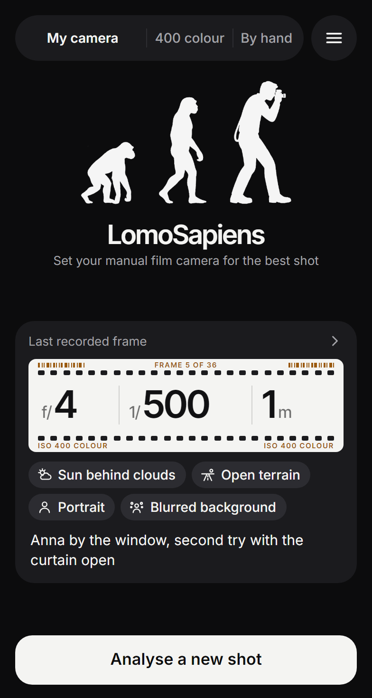
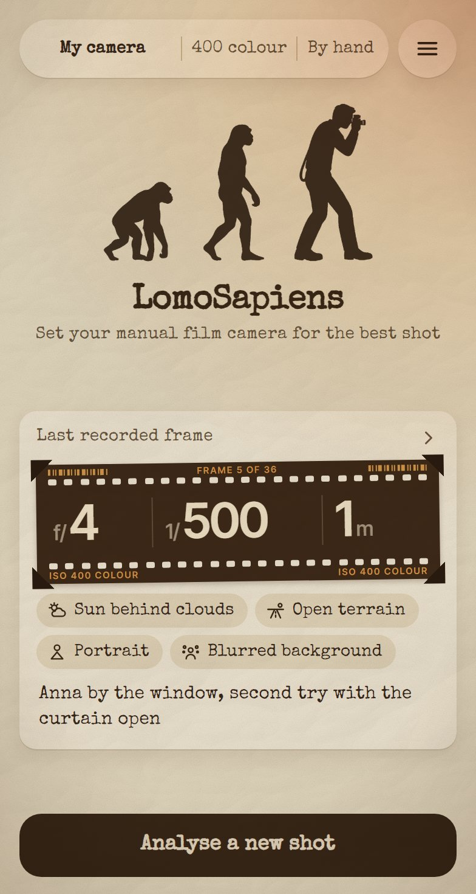
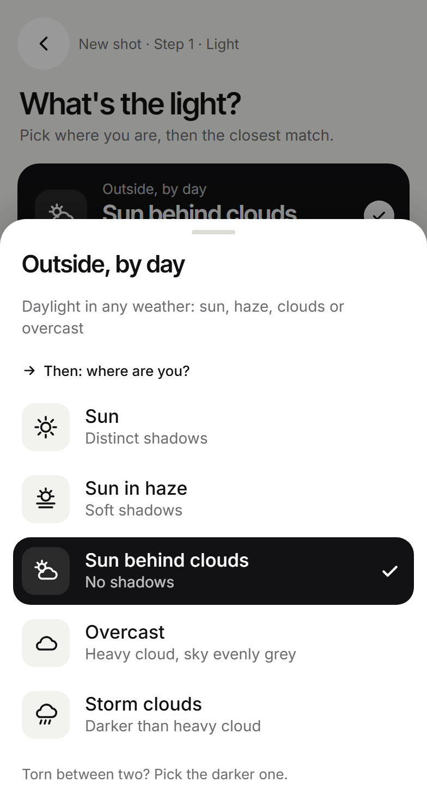
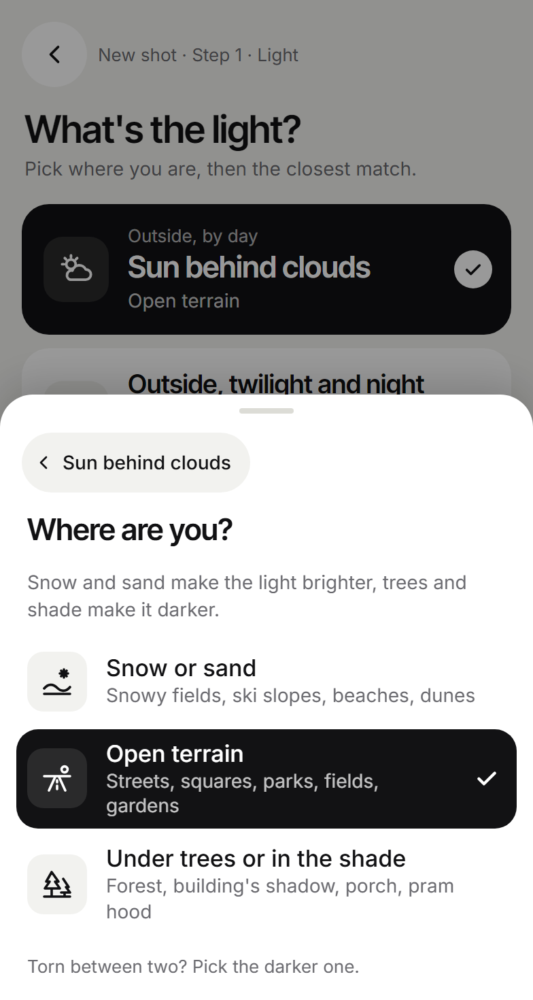
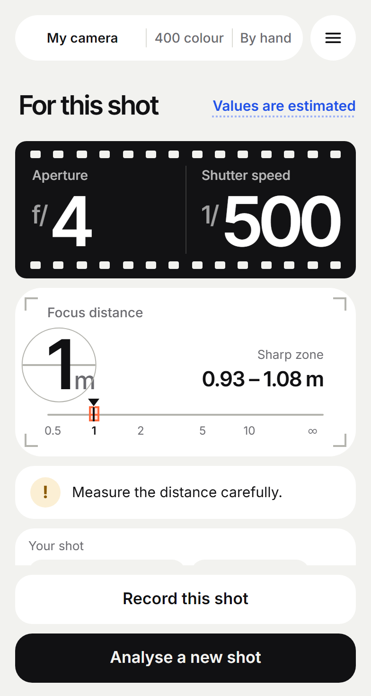
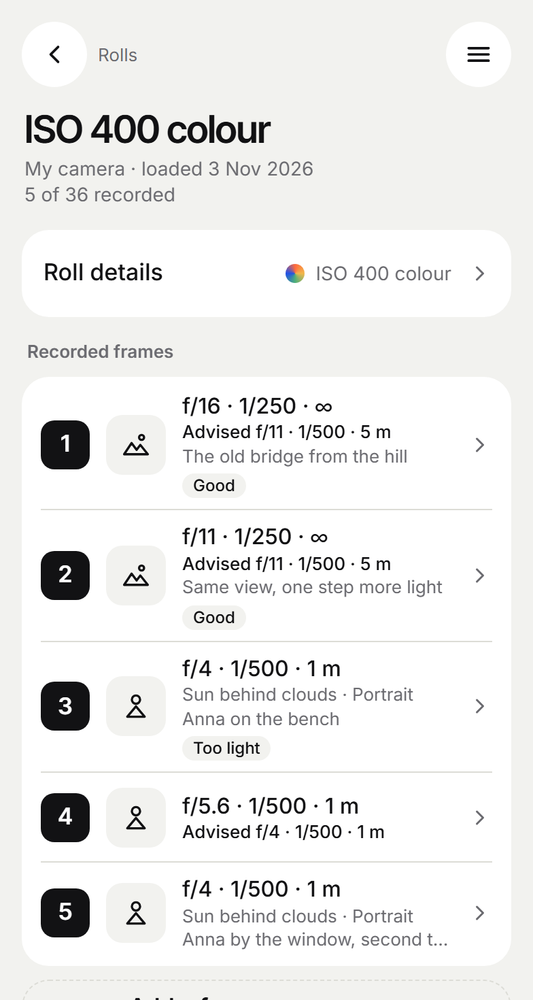
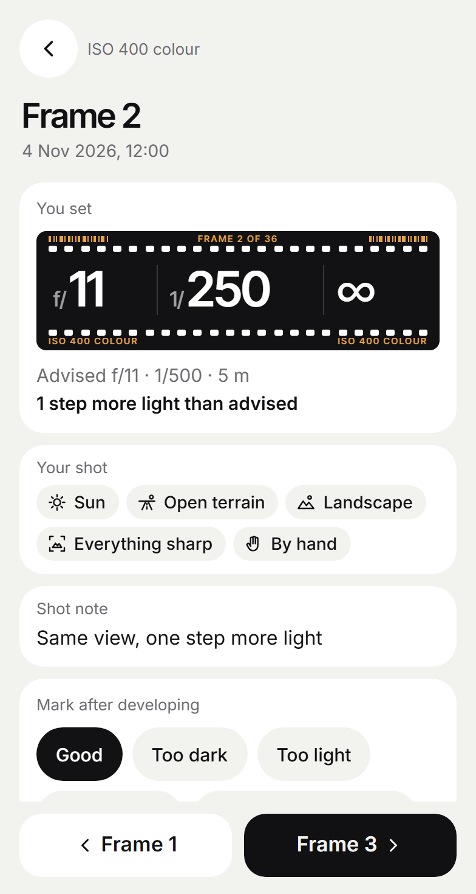
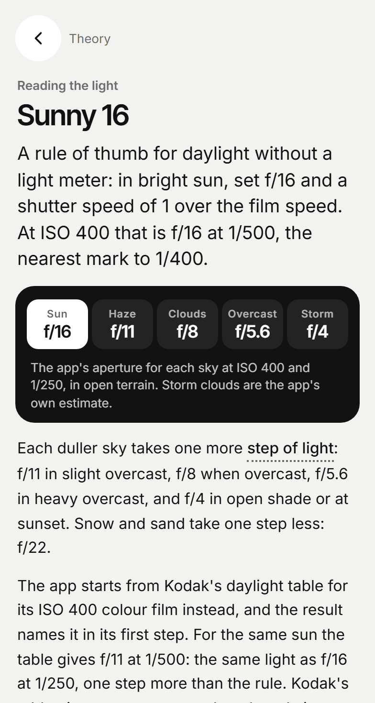

# LomoSapiens

**Set your manual film camera for the best shot.**

LomoSapiens is a free web app for your phone. It tells you what to set on a manual film camera for the shot in front of you. Tap what the light looks like and what you're photographing, and it gives you the aperture, the shutter speed and the focus distance, written the way your camera marks them. It also shows how much of the scene will be sharp and how to hold the camera, and says why.

It's made for beginners who shoot film without a light meter, and who otherwise find out weeks later, at the lab, that half the roll came out too dark or blurred.

**Try it: [lomosapiens.pages.dev](https://lomosapiens.pages.dev).** Open it on your phone and add it to your home screen. On a computer it opens in a phone-sized frame.

<p align="center"></p>

<table>
  <tr>
    <td align="center"><br>Home · Light</td>
    <td align="center"><br>Home · Dark</td>
    <td align="center"><br>Home · Archive paper</td>
  </tr>
  <tr>
    <td align="center"><br>The light</td>
    <td align="center"><br>Where you are</td>
    <td align="center"><br>The result</td>
  </tr>
  <tr>
    <td align="center"><br>A roll</td>
    <td align="center"><br>A recorded frame</td>
    <td align="center"><br>Theory</td>
  </tr>
</table>

## What it does

1. **Describe your camera once,** and load a roll of film into it.
2. **Before a shot,** tap what the light looks like, then what you're photographing and what matters most in the photo.
3. **Set what it shows:** the aperture, the shutter speed and the focus distance.
4. **Take the shot,** and record the frame if you like, with the settings you actually used.
5. **After developing,** mark how each frame came out, and see which settings worked.

## Key features

- **Analysing a shot.** The light: the sky and where you are by day, twilight and night, or indoors. What you're shooting, named by how much fills the picture: a portrait, a subject close by, a subject a few steps away, something further off, a landscape or other, at its usual distance for your lens or one you type. And what matters most: a moving subject, a blurred background or everything sharp. The result gives the aperture, the shutter speed and the focus distance as your camera marks them, the sharp zone, how to hold the camera, any warnings, and "How the app got there", step by step. Estimates are marked as such.
- **Your cameras.** Add as many as you have, each described once by its limits: its widest and smallest aperture, its lens's focal length, its fastest and slowest shutter speeds, and whether it has B. "Not sure" picks a value almost every camera has. There is no list of camera models, and the advice never asks for a setting your camera doesn't have. One camera is in use for new shots, and a camera can be added before it has film.
- **Rolls.** Load a roll into a camera with its film speed, colour or black and white, its length (24, 36 or any other) and, if you like, a name. Finish it when it's done: finished rolls stay, with their frames. Home shows the last frame you recorded.
- **Recording a frame.** "Record this shot" on the result opens the phone's camera, and the photo records the frame at once: the next frame number, the settings as advised, and the photo of the scene, to know the frame later. "Change" then fixes the number or settings you set otherwise, and adds a note. Close the camera instead to fill in the form without a photo. A frame you forgot to record can be added later from the roll's page.
- **Marking after developing.** Good, a bit or too dark, a bit or too light, a bit or quite out of focus, blurred by movement, sun flare, double exposure, an offset frame, weird artefacts or other, any of them at once, and a note of several lines, shown in the roll's list.
- **How you hold the camera.** By hand, braced, or on a surface, set once in Settings. It decides the slowest shutter speed the advice will use, down to the camera's slowest, and B for long exposures, on a surface.
- **Theory.** Short articles behind the numbers: steps of light, the exposure triangle, depth of field, movement, flare, lenses and more, each with its sources.
- **Backup.** Everything, photos included, saved to one file that you keep where you like, and restored from it on this phone or another.
- **Three looks:** light, dark, or Archive paper; or as the phone is set.
- **Offline.** It's a web app: it opens in the browser, can be added to the home screen, and works without a connection once it has loaded.

## How it decides

The advice starts from published light values, not from guesses. In daylight, that is Kodak's daylight exposure table for its colour negative film; in twilight and at night, the typical light levels in Wikipedia's "Exposure value" table. On top come a few simple, well-known rules: how slow a shutter you can hold, which pair of settings suits your goal, and how far away to focus.

It's approximate on purpose. It never pretends to be more exact than it is, and it says when a value is an estimate and why. It is made for negative film, colour or black and white, which copes well with a little too much light. It isn't meant for slide film or digital cameras.

The rules and every source are in [`docs/ENGINE_SPEC.md`](docs/ENGINE_SPEC.md), and the Theory articles, with theirs, in [`kb/theory.md`](kb/theory.md).

## Privacy

Everything you enter stays on your phone: your cameras, rolls, frames, notes and photos. There is no account, no tracking and no advertising, and the app never asks where you are. Photos are redrawn without the location your phone writes into them. The browser is told that the app may contact no address but its own.

The other side of this: clearing your browser's data deletes your records too. **Save a backup** from Settings now and then, and keep the file wherever you like.

## Run it on your computer

You need [Node.js](https://nodejs.org/) 24. From the `web` folder:

```
npm install
npm run dev          # the app at the address Vite prints
npm test             # all tests
npm run build        # the published version, in web/dist
npm run serve-built  # that version, with the hosting's security headers
```

In development, a test page at `/test` shows every input and step of the calculation. It isn't part of the published app.

## The project

| Folder | What's in it |
|---|---|
| `web/` | The app: TypeScript, React, Vite and Tailwind. `web/src/lib/engine/` is the calculation, with no network, clock or randomness |
| `kb/` | The Theory articles, with their sources |
| `docs/` | How the app decides, rule by rule with its sources (`ENGINE_SPEC.md`), and the screenshots above |
| `testset/` | The engine's test cases |
| `schema/`, `prompts/` | For the development test page's AI box, which reads a typed description of a shot. It isn't in the published app |

## Credits and licences

- **Code:** MIT, see [`LICENSE`](LICENSE).
- **Fonts:** Inter and Inter Tight, under the SIL Open Font License 1.1; Special Elite, under the Apache License 2.0. Their licence files are in `web/public/fonts/`.
- **The figures on Home** were made for this project by its author with an AI image tool.
- **The paper textures** of Archive paper were generated for this project from noise filters, and the app icon was drawn for it.

## An independent project

LomoSapiens is an independent project by a film enthusiast. It is not affiliated with LOMO or Lomography. It isn't professional software: there is no team behind it and no support. Its advice is a starting point and can be wrong, so check what you can and trust your own judgement.

Enjoy your film, and the wait for every roll.
